<div align="center">

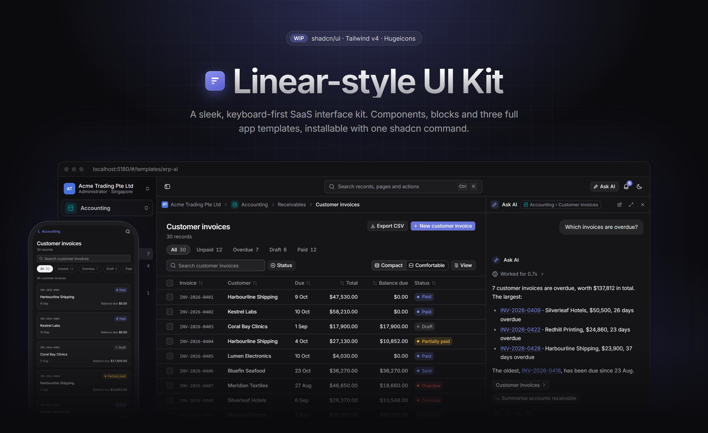

<br>
<br>

**A sleek, keyboard-first SaaS UI kit built with shadcn/ui, Tailwind CSS v4 and Hugeicons.**<br>
Components, blocks and full app templates in one design system,<br>
with every part installable into another project through `npx shadcn add`.

<br>

  

     

[Features](#features) · [Screenshots](#screenshots) · [Quick start](#quick-start) · [Use the parts](#use-the-parts-in-your-own-project) · [Architecture](#architecture) · [How this was built](#how-this-was-built)

</div>

<br>

## Why this exists

Most shadcn/ui apps look like shadcn/ui. This kit is a study in what it takes to get from there to the calm, dense, polished feel of tools like Linear, and to keep that polish when an app grows to dozens of screens.

The answer it tests: **design every part once, then build everything from those parts.** Tokens feed primitives, primitives feed components, components feed blocks, and blocks become whole apps. A screen is never styled on its own, so a new screen inherits the polish instead of re-inventing it.

## Features

<table>
<tr>
<td width="33%" valign="top">

### 🎨 A tuned design system

Near-neutral greys with a faint cool tint, one indigo accent, hairline borders, 13px Inter and 28px controls. Dark by default. Five CSS variables drive every colour, with **12 presets** and a live theme mixer.

</td>
<td width="33%" valign="top">

### 🧩 shadcn/ui, restyled

**47 primitives** on shadcn's compact Mira preset, plus **41 components** of the kit's own: status and priority icons, people, sparklines, QR codes, signature pad, recurrence picker…

</td>
<td width="33%" valign="top">

### 🧱 Blocks for real screens

**95 blocks**: data table with saved views, Kanban, grouped list, Gantt chart, dashboard, inbox, settings, audit log, form builder, command menu, sign-in, and a mobile shell (PWA).

</td>
</tr>
<tr>
<td width="33%" valign="top">

### ✨ An AI kit

**64 AI parts**: chat with branches and a prompt library, projects, knowledge bases with retrieval and citations, agents with triggers and approvals, connectors, skills, memory, voice mode and an admin console.

</td>
<td width="33%" valign="top">

### 🖥️ Three full app templates

An **AI chat workspace**, a multi-module **ERP**, and **ERP + AI** with an assistant that answers from the live records. Desktop and phone layouts, all on made-up data.

</td>
<td width="33%" valign="top">

### 📦 A shadcn registry

Every part is a registry item that brings its files, npm packages and kit dependencies along. The registry rebuilds itself as you edit, and `npm run check` enforces the kit's rules.

</td>
</tr>
</table>

## Screenshots

### The kit

Like Storybook: one page per component family, each with a live playground, a props pane, the code to copy, and a grid of every variant.

<table>
<tr>
<td width="50%">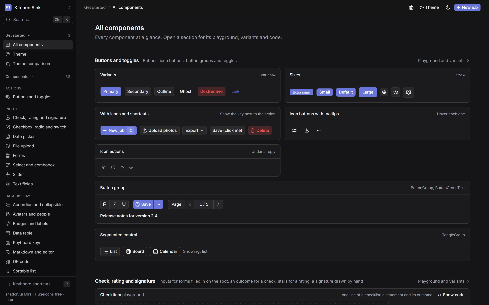</td>
<td width="50%">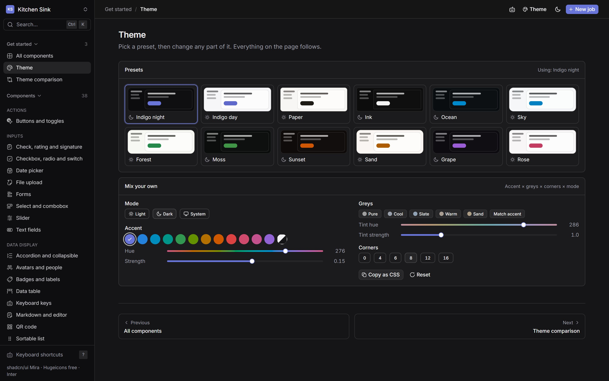</td>
</tr>
<tr>
<td align="center"><sub><b>All components</b> · every part at a glance</sub></td>
<td align="center"><sub><b>Theme</b> · 12 presets, or mix your own and copy it as CSS</sub></td>
</tr>
<tr>
<td width="50%">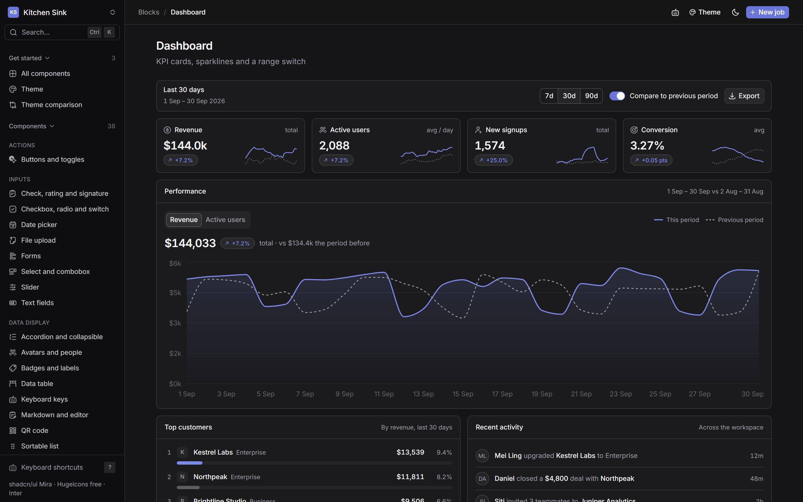</td>
<td width="50%">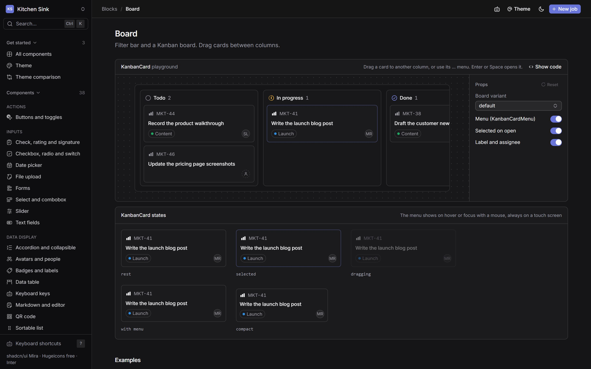</td>
</tr>
<tr>
<td align="center"><sub><b>Dashboard</b> · KPI cards, sparklines, period compare</sub></td>
<td align="center"><sub><b>Board</b> · drag and drop, with every card state</sub></td>
</tr>
</table>

### AI chat workspace

<table>
<tr>
<td width="50%">
<picture>
  <source media="(prefers-color-scheme: light)" srcset=".github/assets/ai-chat-light.jpg">
  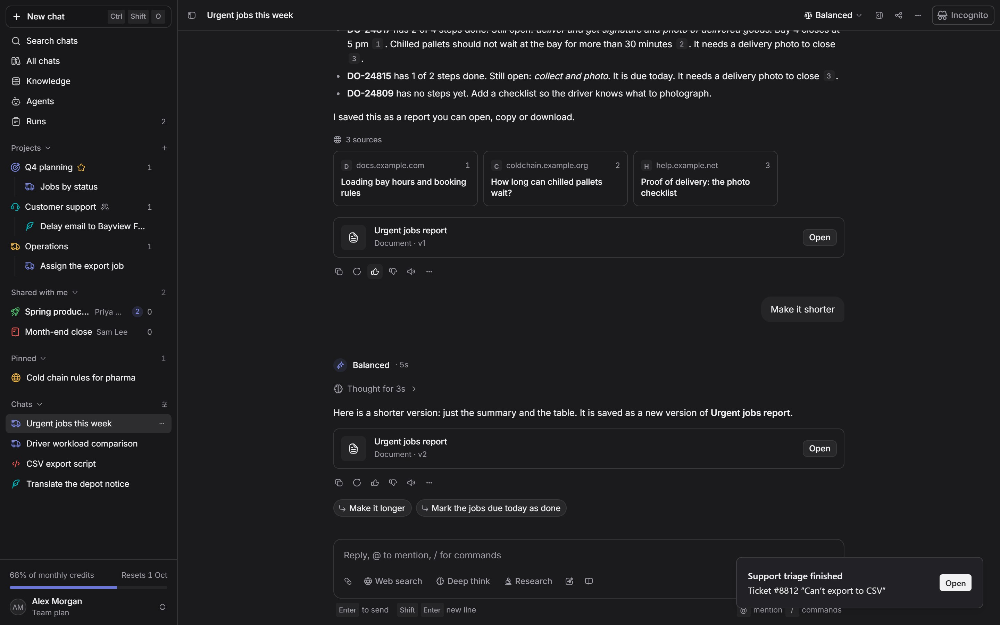
</picture>
</td>
<td width="50%">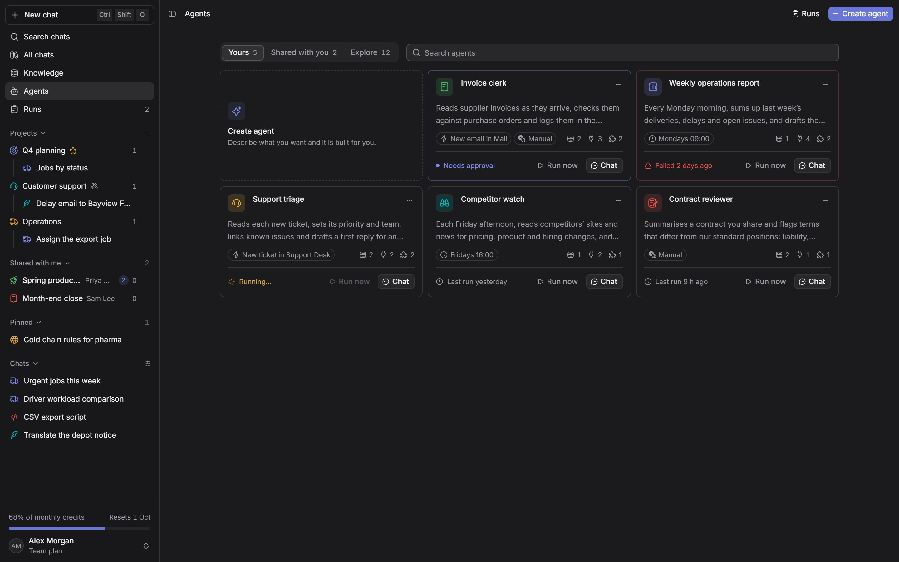</td>
</tr>
<tr>
<td align="center"><sub><b>Chat</b> · sources, artifacts, projects, branches</sub></td>
<td align="center"><sub><b>Agents</b> · triggers, tool permissions, runs and approvals</sub></td>
</tr>
</table>

### ERP

<table>
<tr>
<td width="50%">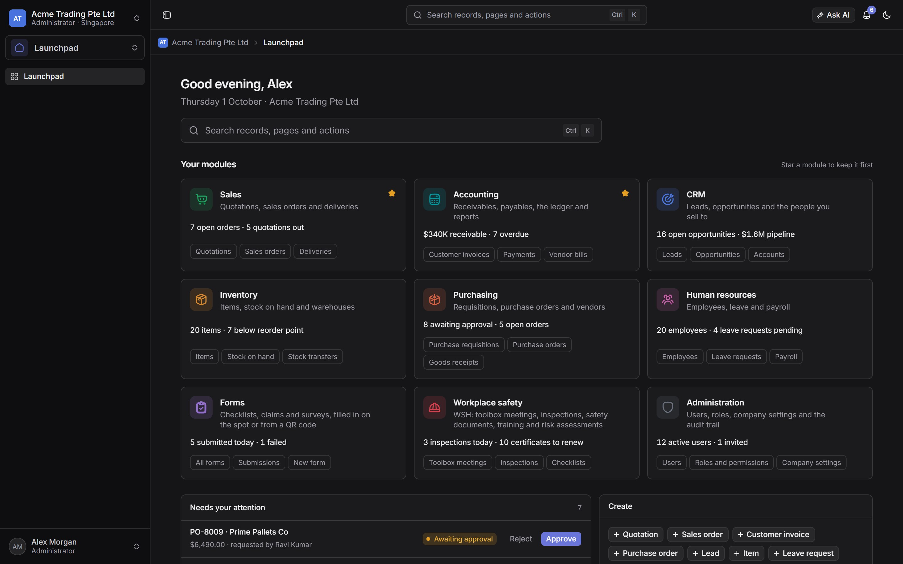</td>
<td width="50%">
<picture>
  <source media="(prefers-color-scheme: light)" srcset=".github/assets/erp-invoices-light.jpg">
  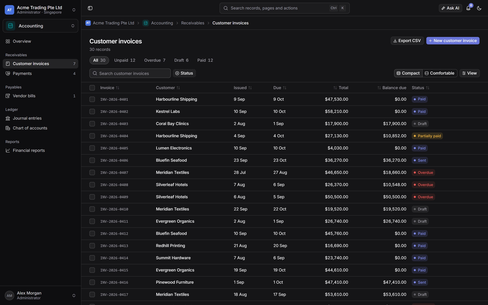
</picture>
</td>
</tr>
<tr>
<td align="center"><sub><b>Launchpad</b> · modules, counts and approvals</sub></td>
<td align="center"><sub><b>List pages</b> · saved views, filters, bulk actions, CSV</sub></td>
</tr>
</table>

### On a phone

Below 768px wide the apps switch to a real mobile shell, not a squeezed desktop layout.

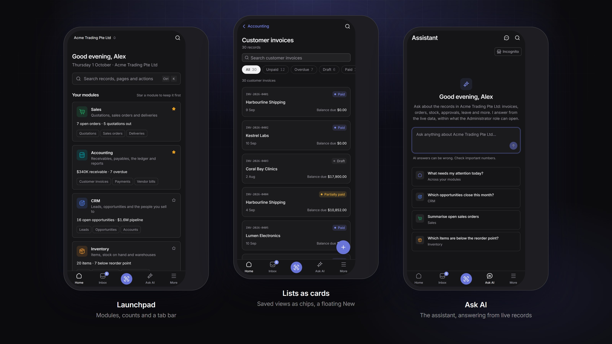

> [!TIP]
> Screenshots follow your GitHub theme. Switch between light and dark to see both modes.

## Quick start

```bash
git clone https://github.com/alvinphee/linear-style-ui-kit.git
cd linear-style-ui-kit
npm install
npm run dev
```

Open **http://localhost:5180**. The port is deliberately not Vite's default, so the kit runs beside another Vite app; set `PORT` to change it.

Then try:

| Address | What you'll see |
| --- | --- |
| `#/overview` | Every component on one page |
| `#/theme` | The theme presets and mixer |
| `#/templates/ai-chat` | The AI chat workspace, full window |
| `#/templates/erp` | The ERP. Sign in with any email and password |
| `#/templates/erp-ai` | The ERP with the AI assistant built in |

<details>
<summary><b>Keyboard shortcuts</b></summary>
<br>

| Keys | Action |
| --- | --- |
| <kbd>Ctrl</kbd> <kbd>K</kbd> / <kbd>⌘</kbd> <kbd>K</kbd> | Command menu |
| <kbd>?</kbd> | All shortcuts |
| <kbd>C</kbd> | Create (a job in the kit, a record on an ERP list) |
| <kbd>G</kbd> then a letter | Go to a page or module (<kbd>G</kbd> <kbd>B</kbd> board, <kbd>G</kbd> <kbd>S</kbd> settings…) |
| <kbd>Ctrl</kbd> <kbd>J</kbd> | Ask AI (ERP) |
| <kbd>[</kbd> | Hide the sidebar (ERP) |

</details>

<details>
<summary><b>All scripts</b></summary>
<br>

| Script | What it does |
| --- | --- |
| `npm run dev` | Dev server on port 5180, rebuilding the registry as parts change |
| `npm run check` | The kit's rules (below), checked on every file |
| `npm run registry` | Rebuild `registry.json` and the registry's JSON files |
| `npm run build` | Type-check, rules, then a production build |

</details>

## Use the parts in your own project

The kit is a [shadcn registry](https://ui.shadcn.com/docs/registry). With the kit's dev server running, name it once in your project's `components.json`:

```json
{
  "registries": {
    "@kit": "http://localhost:5180/r/{name}.json"
  }
}
```

Then install the theme first, and any part after it. Each part brings the files, npm packages and other kit parts it needs:

```bash
npx shadcn add @kit/tokens @kit/kanban-board
npx shadcn add @kit/ai-kit   # every AI part at once
```

## Architecture

The kit follows **atomic design**: each level is built only from the levels below it, and every part has exactly one home.

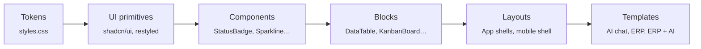

The main rules, most of them enforced by `npm run check`, which runs on every build:

- **Colours only through tokens.** No Tailwind palette classes such as `text-amber-600`, so every theme and mode stays consistent.
- **No level imports from a level above it.** A block can use components, never a template.
- **Blocks take data as props** and hold no sample data, which is what makes them installable elsewhere.
- **Free Hugeicons only**, imported by name. Lucide is never installed.
- **The registry must be current.** A part changed without rebuilding `registry.json` fails the check.

<details>
<summary><b>Project structure</b></summary>
<br>

```text
src/
├── styles.css        the design tokens: colours, type, radius
├── components/
│   ├── ui/           shadcn/ui primitives, restyled
│   ├── ai/           AI components
│   └── *.tsx         the kit's own components
├── blocks/           whole screens: props in, no sample data
│   └── ai/           the AI kit's blocks
├── lib/              plain functions and hooks, no UI
├── templates/        whole apps: ai-chat, erp, erp-ai
└── pages/            the kit's own pages, playgrounds and demos
scripts/
├── check-rules.mjs   npm run check
└── build-registry.mjs  writes registry.json from each part's imports
docs/
├── architecture.md   the levels, and where each part goes
└── glossary.md       the industry terms the kit uses
```

</details>

## Tech stack

| Layer | Tools |
| --- | --- |
| **Framework** | React 19, TypeScript, Vite |
| **Styling** | Tailwind CSS v4, shadcn/ui (Mira preset, Radix), Inter |
| **Icons** | Hugeicons free set, 6,000+ icons |
| **Data** | TanStack Table |
| **Interaction** | cmdk (command menu), sonner (toasts) |
| **Distribution** | shadcn registry, built by a custom script |

## How this was built

This kit was built with **[Claude Code](https://claude.com/claude-code)**, Anthropic's AI coding agent, which wrote most of the code. Every commit is co-authored with Claude, and you can see it in the history.

My role was designer, architect and reviewer:

- **Direction.** I chose the look to aim for, the stack, and the shape of the kit: atomic design levels, a Storybook-style showcase, and full apps that prove the parts work together.
- **Rules for the agent.** I wrote the standards the agent works to ([`CLAUDE.md`](CLAUDE.md), [`docs/architecture.md`](docs/architecture.md), [`docs/agent-brief.md`](docs/agent-brief.md)): one home per part, colours only through tokens, industry terms from [`docs/glossary.md`](docs/glossary.md), and every screen checked in light mode, dark mode and at 375px wide.
- **Guardrails.** Rules that matter are enforced by code, not just written down: [`scripts/check-rules.mjs`](scripts/check-rules.mjs) fails the build when a part breaks them.
- **Review.** I reviewed the screens and steered the changes, and recorded what we learned in [`docs/findings.md`](docs/findings.md).
- **Experiments.** I tested what actually drives UI quality with an AI agent: the brief, the project setup or the model. The answer shaped how this kit is organised: polish comes from parts designed once and reused, not from instructions alone.

## Status

🚧 **Work in progress.** The kit, the AI kit and all three templates run today. Next:

- [ ] A hosted demo
- [ ] The registry at a public URL, so `shadcn add` works without running the kit
- [ ] Tests for the blocks

---

<div align="center">
<sub>
Inspired by the look of <a href="https://linear.app">Linear</a>. Not affiliated with or endorsed by Linear; no Linear code, logos or assets are used.<br>
Built by <a href="https://github.com/alvinphee">Alvin Phee</a>.
</sub>
</div>
